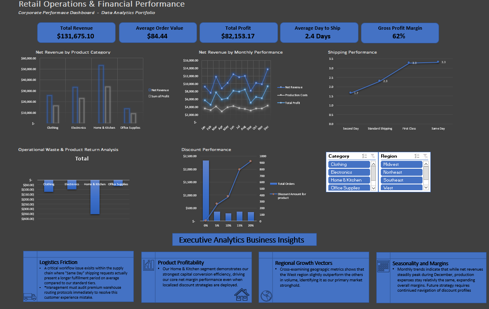

# Retail Operations & Financial Performance Dashboard

## Project Overview
An interactive executive dashboard designed to track sales performance, profitability, and fulfillment efficiency. Built to transform raw transactional records into an automated, self-service reporting tool for leadership.
## Key Performance Indicators (KPIs)
* **Total Revenue & Total Profit:** Tracks top-line sales growth against bottom-line earnings.
* **Gross Margin (%):** Evaluates product and category profitability after accounting for costs.
* **Average Order Value (AOV):** Measures customer purchasing behavior and basket size.
* **Average Days to Ship:** Monitors fulfillment speed and operational bottlenecks.
* ## Tools & Technical Workflow
* **Power Query (ETL):** Automated data extraction and cleaning—removed duplicates, standardized text and date formats, handled missing values, and engineered calculated columns (e.g., Revenue, Profit, and Shipping Duration).
* **Pivot Tables & Charts:** Aggregated multi-dimensional sales data to uncover revenue trends, top-performing categories, and regional variances.
* **Dynamic Slicers & KPI Cards:** Built interactive filters allowing users to slice performance metrics dynamically across time periods, product lines, and regions.
## How to Use
1. View the dashboard preview above for a high-level summary of findings.
2. Download the `.xlsx` workbook from this repository to interact with the live slicers and explore the underlying Power Query steps and Pivot Tables
